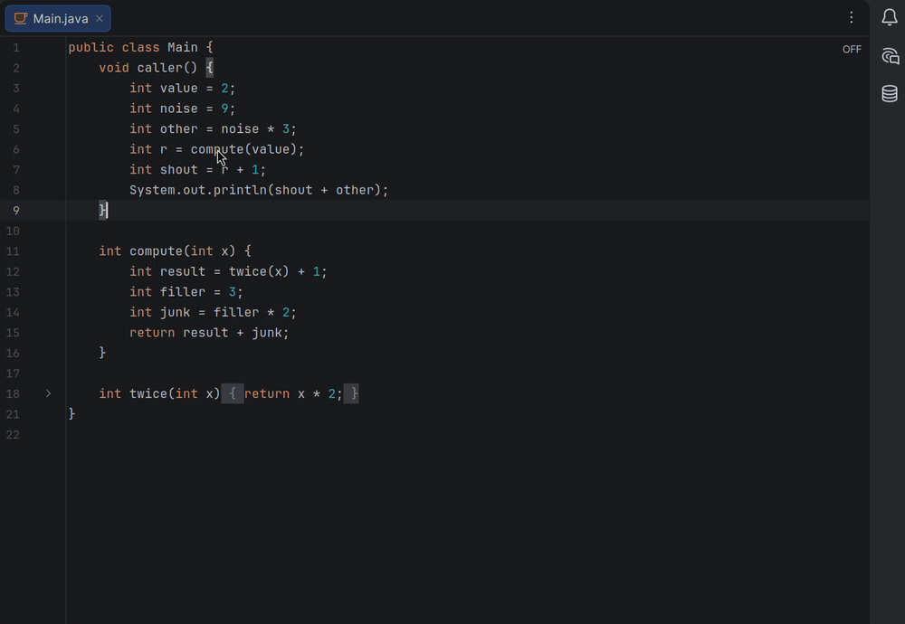
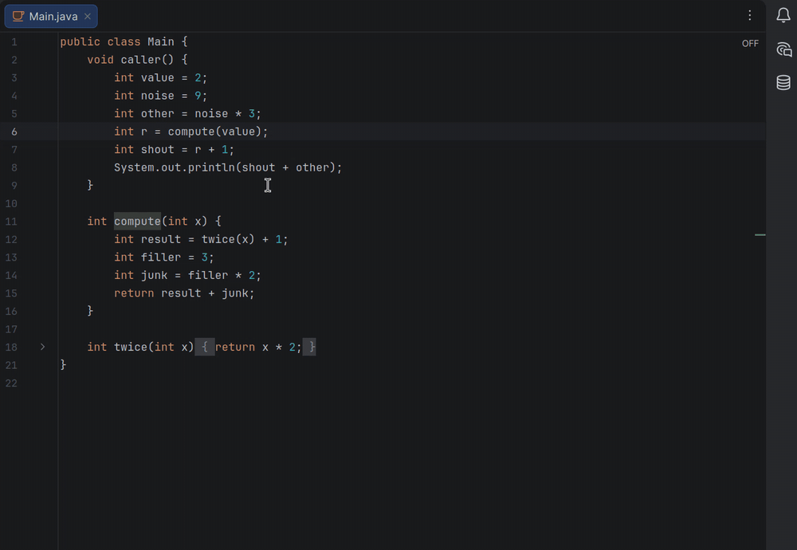

# Inline Reading Mode

All the code here is written by AI (Claude Code) and has not been reviewed.

An IntelliJ plugin for reading Java code without jumping between files.

Put the caret on a method call and press **Alt+,**. The body of the called method opens right
under the call, read only, with syntax colors. It works inside that body too, so you can open a
whole chain of calls in one place. **Alt+,** again, **Esc** or a click on the frame's header closes
it. The file stays editable the whole time.

## Follow a value

- **Alt+.** track the parameter or variable at the caret. Every line that touches it gets a color.
- **Alt+;** pick what to track from a list: the method's parameters, locals and the class fields.
- **Alt+'** follow the value instead of the name: everything computed from it, and everything that
  writes into it, gets the same color, lighter.
- **Alt+Shift+;** fold away every line that does not touch what you track.
- **Alt+Shift+'** what the fold keeps: lines that read or write a tracked value, or only the writes.

A tracked variable passed into a call you opened is tracked as the parameter inside it, so you can
follow one value through the whole chain.

## Record a debug run, replay it, ask "what if"

- **Alt+Shift+D** start or stop recording the debug session.
- **Alt+Shift+U** stopped at a breakpoint: record from here until this method returns.
- **Alt+Shift+P** replay a recording. The editor looks like a paused debugger: the current line,
  the values each line changed, the lines that never ran in grey. **F8 F7 Shift+F8** step forward,
  **Alt+Shift+F8 / F7** step back.
- **Alt+Shift+E** what if: stopped at a breakpoint, give the variable at the caret another value and
  see the rest of the method run next to the original.

## Install

Take the zip from the Releases page, or build it:

    ./gradlew buildPlugin    # build/distributions/inliner-0.1.0.zip

In IntelliJ: Settings, Plugins, the gear icon, Install Plugin from Disk, pick the zip, restart.
It needs IntelliJ IDEA 2026.2 or 2026.3. Java code only, for now.

## What it does on your machine

- Runs inside IntelliJ, like any plugin. No network.
- Recordings of debug runs are saved as local files, in the IDE's own folders.

## Build and test

You need a JDK to run Gradle; Gradle downloads the JDK the build itself uses. The first build also
downloads the IntelliJ platform into the Gradle cache, once.

    ./gradlew test           # the tests
    ./gradlew runIde         # a sandbox IntelliJ with the plugin, for trying things
    ./gradlew verifyPlugin   # JetBrains' Plugin Verifier

## How it works

An opened call is a real, read-only editor on the called file, cut down to the method and placed
as a block under the call line. IntelliJ's code navigation works inside it, so calls inside it can
be opened the same way.
